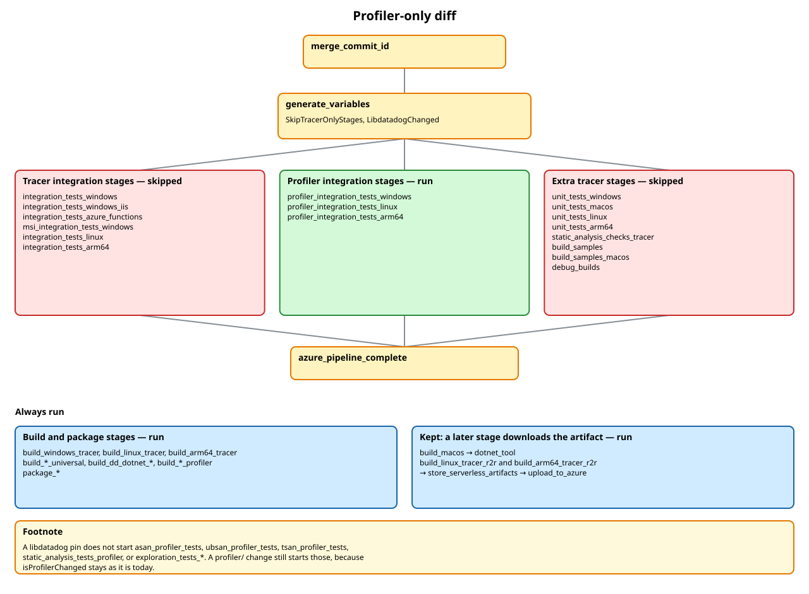
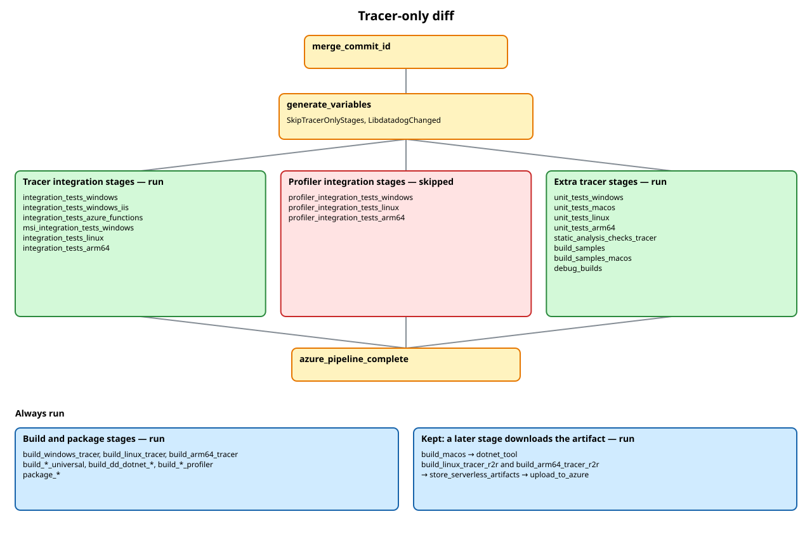
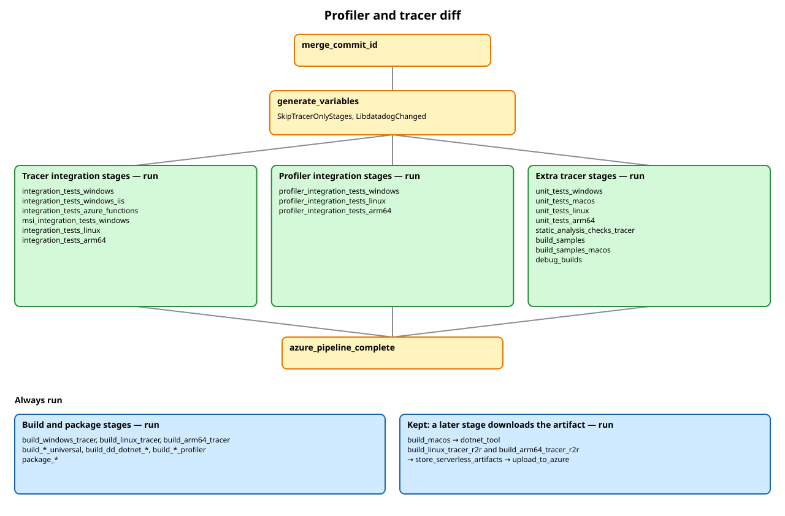

# Integration test selection

`generate_variables` reads the pull request diff and sets two outputs.

`SkipTracerOnlyStages` is true when every path that is not on the pipeline ignore list is profiler-only (`profiler/`, a libdatadog pin, or `tracer/test/Datadog.Trace.Tests/ContinuousProfiler/`). The six tracer integration stages then skip their test jobs, and so do `unit_tests_*`, `static_analysis_checks_tracer`, `build_samples`, `build_samples_macos`, and `debug_builds`. Each of those stages still posts its GitHub check as success, with description `Skipped: profiler-only diff`.

`LibdatadogChanged` is true when the diff touches `build/cmake/FindLibdatadog.cmake` or `build/vcpkg_local_ports/libdatadog/`. The three profiler integration stages run. A pin does not, by itself, start the sanitizer stages, `static_analysis_tests_profiler`, or `exploration_tests_*`. A `profiler/` change still starts those, because `isProfilerChanged` is unchanged.

On `master`, `release/*`, `hotfix/*`, and on a scheduled build of the default branch, `SkipTracerOnlyStages` is false, so both groups run. `tracer/src/Datadog.Trace/ContinuousProfiler/` is not profiler-only, so that diff runs both groups too.

Build and package stages always run. `build_macos` and both ReadyToRun tracer builds always run, because a later stage downloads their artifacts on every pull request.

## Profiler-only

## Tracer-only

## Profiler and tracer

Drawings: [profiler-only.excalidraw](profiler-only.excalidraw), [tracer-only.excalidraw](tracer-only.excalidraw), [profiler-and-tracer.excalidraw](profiler-and-tracer.excalidraw).
